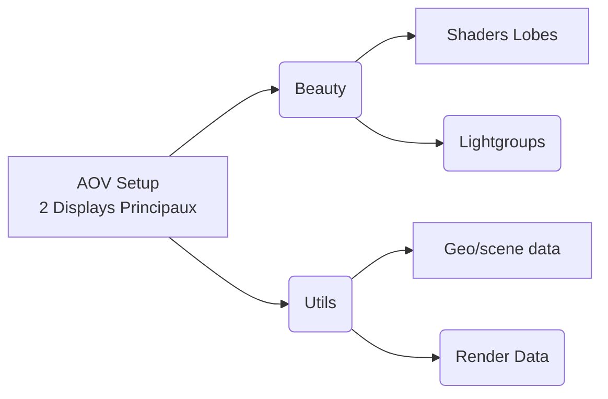

---
{"dg-publish":true,"permalink":"/3_GARDEN/Notes permanentes/AOV/","tags":["note_permanente"],"ctime":"2026-03-22T12:15:21.574+01:00","mtime":"2026-04-24T17:43:18.605+02:00","dg-note-properties":{"MOC":["[[3_GARDEN/MOCs/COMPOSITING]]"],"source":["[[3_GARDEN/Notes littéraires/Cours compositing Rebuild Shot (insecte 3D2)]]"],"Projets":null,"tags":["note_permanente"],"creation date":"2025-05-01","aliases":null}}
---

## La note

Il est possible d’écrire certaines informations supplémentaires à partir de l’image rendue & de l’information contenue dans la scène 3D. Ces informations, appellées **Arbitrary Output Variables (=AoVs)**, sont calculées en même temps que le rendu final. Elles sont ensuite dérivées et écrites séparément du rendu final.

> [!NOTE]+ Beauty render (Renderman)
> Lorsqu’on rend juste une image, par défaut, RenderMan va exporter la **Beauty**. Il s’agit d’une image qui contient deux Layers d’informations:
> 1. **Ci**  = Beauty RGB — Couleur du rendu brut; 
> 2. **a** = Alpha — Opacité du rendu (0= pas d’object rencontré par les rayons lancés depuis la caméra, 1= un objet est présent dans la scène, et valeurs entre 0 et 1 en cas de valeurs non-entières d’opacité)
> 
> Toutefois, il existe d’autres informations qu’il est possible d’exporter lors du rendu, qui s’appellent des Passes. Pour cela, il faut se rendre dans les RenderSettings, puis dans l’onglet “RenderMan/AOVs”. 

> [!NOTE] AOVs built-in et non built-in
> Certains de ces **AOVs** sont directement dérivés de l'image Beauty, et sont appelés **AOVs** intégrés (**Built-In**). Ils ne nécessitent pas de temps de calcul supplémentaire pour obtenir l'image rendue.
> 
> Certains autres nécessitent effectivement un temps de calcul supplémentaire pour obtenir l'image rendue.

> [!abstract]+ AOV Setup dans 2 Displays principaux : 
> - Beauty : *filtered AOVs*
> 	- Au moins l'albedo
> 	- Valeurs RGB pour chaque Shader Lobe -> voir [[3_GARDEN/Notes permanentes/Shader Lobes\|Shader Lobes]] pour une description en détail
> 	- Valeurs RGB pour chaque [[LightGroup\|LightGroup]]
> - Utils : Informations relatives aux données de rendu et de la scene, *non filtered AOVs* (détail plus bas)
> 	- Geometry/Scene data : *id, depth, __Depth, __PWorld, __NWorld, __st, motion, dPdtime, dPCameradtime; etc*
> 	- Render data : *cpuTime, sampleCount; etc*
> 
> Après le rendu, nous voulons **denoise** les **AOVs BEAUTY**, mais pas les **AOVs UTILITIES**

#### AOVs setup Renderman

Créer des custom AOVs : Doc détaillée Renderman : [rmanwiki-26.pixar.com/space/RFM26/21037126/Custom+AOV+Creation](https://rmanwiki-26.pixar.com/space/RFM26/21037126/Custom+AOV+Creation)

![[Screenshot_6a.webp]]

- **ÉTAPE #1** — Sélectionnez _un ou plusieurs_ **AOVs** que vous souhaitez ajouter à votre **Display** ;
- **ÉTAPE #2** — Sélectionnez le **Display** dans lequel vous souhaitez ajouter les **AOVs** ;
- **ÉTAPE #3** — **Cliquez** sur ce **bouton** (**3**) pour **ajouter** les **AOVs** ;

Créer un nouveau display : bouton + en bas à gauche de la fenêtre **2**. 

## Références 

Les AOVs sont des layers (voir [[Couches d'une image numérique]])

- [[Shader Lobes]]
- [[AOVs Utilitaires]]

## Liens 

