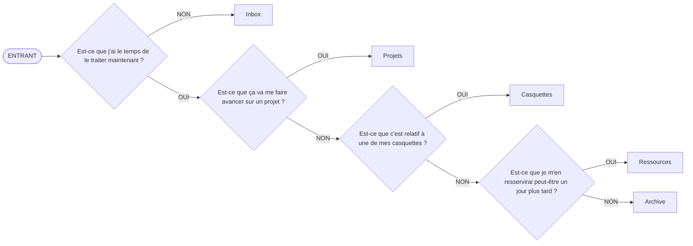

---
{"dg-publish":true,"permalink":"/3_GARDEN/Notes permanentes/Méthode IPCRA/","tags":["note_permanente"],"ctime":"2026-04-04T12:24:04.940+02:00","mtime":"2026-06-04T15:18:39.937+02:00","dg-note-properties":{"MOC":["[[3_GARDEN/MOCs/IA]]","[[3_GARDEN/MOCs/GESTION DE CONNAISSANCE PERSONNELLES]]"],"source":["[[3_GARDEN/Notes littéraires/Bootcamp IA gratuit perspectives, série de vidéos]]"],"Projets":null,"tags":["note_permanente"],"creation date":202604041129,"aliases":null}}
---

## La note 

Organisation de fichiers d'Elliot Meunier qui s'appuie sur la [[3_GARDEN/Notes permanentes/Méthode PARA\|Méthode PARA]] de Tiago Forte, elle même inspirée de la [[3_GARDEN/Notes permanentes/Méthode GTD\|Méthode GTD]] de David Allen. 
Le paradigme est le suivant : On ne classe pas par thème mais par utilité

C'est l'architecture de la clarté d'esprit

Donc pour ranger quelque chose on ne se demande pas : de quoi ça parle ? Mais plutôt : A quoi ça sert et quand je veux pouvoir le retrouver ?

Les 5 dossiers IPCRA : 

| **Dossier**      | **Question**          | **Exemple**                   |
| ---------------- | --------------------- | ----------------------------- |
| **0 INBOX**      | Je ne sais pas encore | Idée captée vite fait         |
| **1 PROJETS**    | Ça a une fin ?        | "Lancer mon podcast"          |
| **2 CASQUETTES** | C'est permanent ?     | "Entrepreneur", "Parent"      |
| **3 RESSOURCES** | C'est une référence ? | Articles, guides, inspiration |
| **4 ARCHIVES**   | C'est terminé ?       | Projet fini, casquette fermée |

Donc on a un arbre de décision qui se dessine : 

## Références

Bien sur cette arborescence est flexible : 
Si on ajoute la [[3_GARDEN/Notes permanentes/Méthode Zettelkasten\|Méthode Zettelkasten]] on peut ajouter un dossier GARDEN par exemple

> [!example]- Flashcards
> ...

## Liens 
